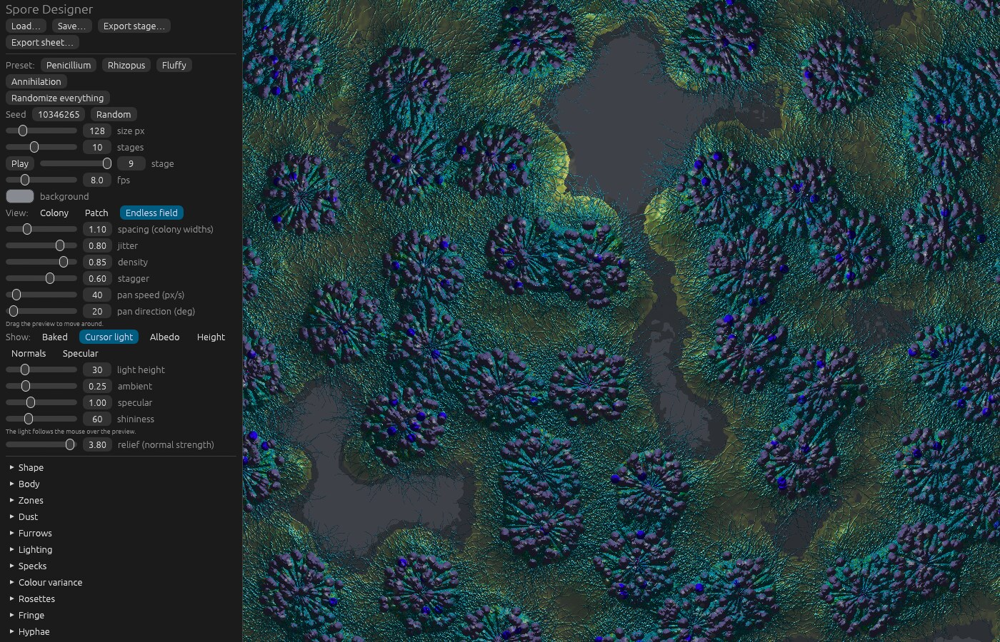
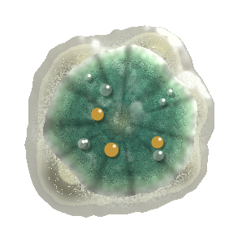
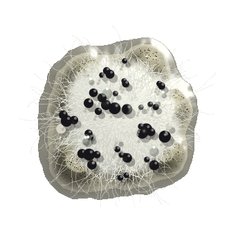
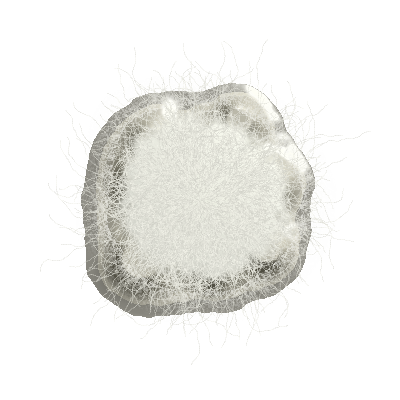
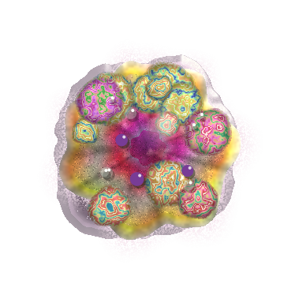

# Spore Designer

Design procedural moulds by twiddling parameters, from plain fluff to lurid lichen blooms.
The painters started as the Penicillium and Rhizopus colonies of
[Sporagon](https://github.com/sunsided/sporagon), generalised into one layered generator.



- `crates/spore-core`: pure painter (`MoldParams`, seed, growth → RGBA sprite). No platform
  dependencies; builds for `wasm32-unknown-unknown`.
- `crates/spore-designer`: desktop editor on [game-toolkit](https://game-toolkit.dev/) + egui.
  Presets, live sliders, "randomize everything", growth playback, RON save/load, PNG and
  sprite-sheet export.

The presets, each as one fully grown colony (`task docs:presets` renders these):

| Penicillium | Rhizopus | Fluffy | Annihilation |
|:-:|:-:|:-:|:-:|
|  |  |  |  |

Three views:

- **Colony**: one colony in its slime puddle. It may grow past its cell; the image is padded,
  never cut off.
- **Patch**: several colonies on one square, growing at staggered times. Their puddles share
  one metaball field, and with *meld* their bodies fuse into one mass.
- **Endless field**: colonies on an infinite jittered grid, painted in seamless chunks on
  worker threads while the view pans (drag it, or let it drift).

Every view can also be shown relit by a light that follows the mouse, or as one of its
lighting maps: albedo (colour without baked light), height, normals and specular. Exports
write those maps next to the picture (`-albedo`, 16-bit `-height`, OpenGL `-normal`,
`-specular`), ready for real-time lighting in a game.

```sh
task run        # or: cargo run --release -p spore-designer
task web        # the browser version on http://localhost:8080 (needs trunk)
task web:build  # the browser version into crates/spore-designer/dist
task check      # fmt, clippy (desktop and web), tests
```

The browser version is the same app built for WebAssembly. Browsers give it no threads, so
painting runs in small slices between frames and pictures fill in progressively; Save and
Export become downloads. `.github/workflows/pages.yml` publishes it on GitHub Pages.

On Linux the toolkit's audio and gamepad crates need `libasound2-dev libdbus-1-dev libudev-dev`.
